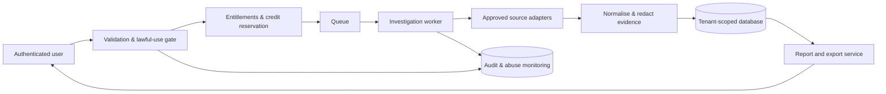

# FyndEt — Technical Architecture

## Proposed platform (confirm deployment support)
- **Web:** Next.js App Router + TypeScript, accessible component system, server-rendered marketing.
- **API:** server-side route handlers or isolated API service with typed contracts and Zod validation.
- **Auth:** secure managed authentication with email verification, MFA support, session rotation, CSRF protection and organisation RBAC.
- **Database:** PostgreSQL with migrations, row/tenant ownership checks and encrypted sensitive columns.
- **Async execution:** Redis/BullMQ or managed queue + isolated worker for bounded, retryable investigations.
- **Billing:** payment provider hosted checkout, customer portal and signed webhook processing.
- **Storage:** private object store for encrypted, time-limited report exports with signed URLs.
- **Observability:** structured metrics, traces and security events, PII-masked logs and alerting.

## Key entities
`users`, `organisations`, `memberships`, `plans`, `subscriptions`, `usage_ledger`, `investigations`, `investigation_authorisations`, `jobs`, `provider_runs`, `findings`, `evidence`, `reports`, `audit_events`, `abuse_events`, `privacy_requests`.

## Investigation state machine
`created -> authorised -> queued -> running -> completed | partial | failed | cancelled | expired`.
All transitions are validated server-side and timestamped. Payment/permission revocation stops future provider requests. Each provider execution records cost, eligibility, outcome and error class.

## Data flow


## Connector interface
```ts
type FindingStatus = "observed" | "possible" | "not_found" | "not_checked" | "source_unavailable";
interface SourceAdapter {
  id: string;
  category: "domain" | "public_reference" | "breach";
  requiresVerifiedOwnership: boolean;
  permittedPurposes: string[];
  check(input: {
    email: string;
    organisationId: string;
    investigationId: string;
    authorityId: string;
    signal: AbortSignal;
  }): Promise<{
    status: FindingStatus;
    observations: Array<{
      sourceReference: string;
      collectedAt: string;
      confidence: number;
      matchBasis: string;
      redactedSummary: string;
    }>;
  }>;
}
```
Provider secrets stay server-side. Each adapter must enforce contractual terms, data minimisation, caching limits and redisclosure restrictions. No simulated source may be enabled in production.

## API sketch
- `POST /api/investigations` — validate purpose/authority, enforce credit reservation, create job.
- `GET /api/investigations` — tenant-filtered history with cursor pagination.
- `GET /api/investigations/:id` — authorised redacted findings.
- `POST /api/investigations/:id/export` — entitled, logged, constrained export.
- `GET /api/billing/entitlements` — actual server-calculated state.
- `POST /api/billing/checkout` — checkout-session creation.
- `POST /api/webhooks/billing` — signed, idempotent event handling.
- `POST /api/privacy/requests` — access/correction/objection/deletion workflow.

## Security baseline
Use OWASP ASVS as verification framework, least-privilege IAM, parameterised queries, encrypted transport and storage, provider egress restrictions, abuse-sensitive rate controls, WAF/captcha when proportionate, backup/restoration drills, secret rotation and external security review. Never index results or leak target emails in analytics, URLs, search logs or third-party client scripts.

## Environment
Deployment target, billing gateway, domain, provider contracts and privacy counsel review are **unconfirmed**. They are prerequisites to a production rollout.
 

## Mandatory cPanel-compatible production architecture (2026-10-22)
The general TypeScript/Next.js/Redis architecture above is exploratory and **not** the default production stack. cPanel operation is a hard requirement. Prefer PHP 8.2+ with PDO and MySQL/MariaDB behind Apache, with progressively enhanced accessible HTML/CSS/JS bundled into deployable static assets. Database-backed cron-triggered workers are the required baseline. Deploy with public web root separation, production .htaccess rules, strict file permissions, per-account configuration and non-root CLI tooling. Do not rely on a permanently running worker, Docker, Redis, or a Node app runtime without verifying they are explicitly supported by the target cPanel subscription. Build, migrate, back up, rollback and smoke-test instructions must be furnished for cPanel. Maintain optional decoupled frontend technology only if its built output can be hosted reliably in this environment.
